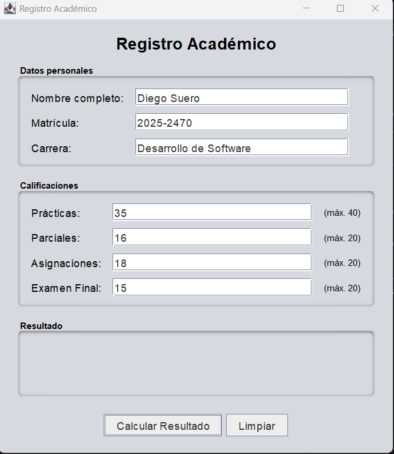
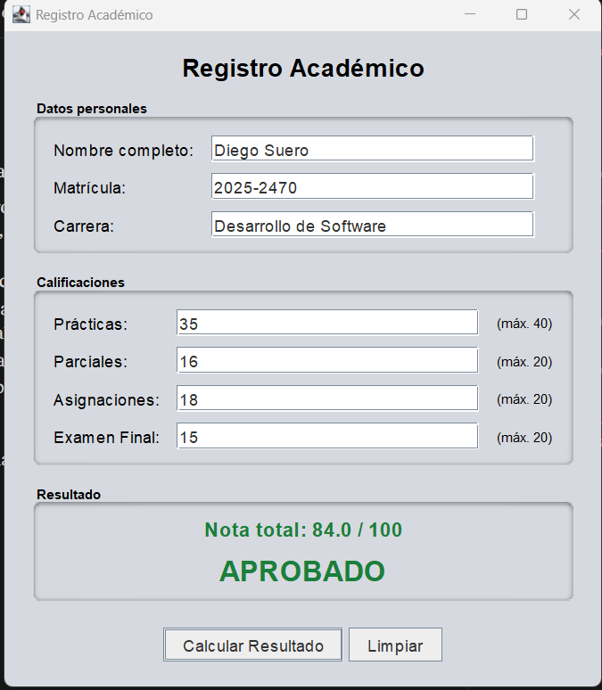
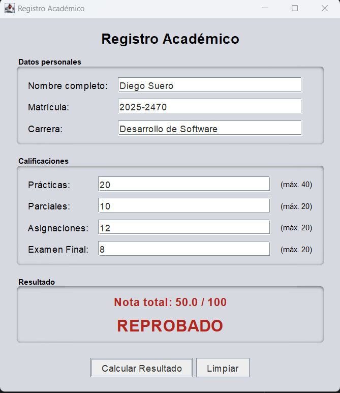
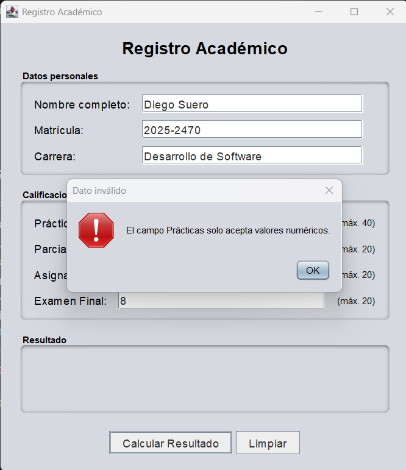

# Registro Académico

Aplicación de escritorio en **Java Swing** que captura los datos personales de un estudiante y sus calificaciones, calcula la nota total y muestra si **aprobó** (≥ 60) o **reprobó**.

Tarea Práctica 3 – Programación 1 (Java, POO).

## Estructura de calificación

| Componente    | Máximo |
|---------------|--------|
| Prácticas     | 40     |
| Parciales     | 20     |
| Asignaciones  | 20     |
| Examen Final  | 20     |
| **Total**     | **100**|

Se aprueba con una nota total **≥ 60**.

## Estructura del proyecto

```
src/
├── Estudiante.java            # Clase POO: datos, validación y cálculo
├── RegistroAcademicoGUI.java  # Interfaz Swing
└── Main.java                  # Punto de entrada
capturas/                      # Capturas de pantalla
```

## Principios de POO aplicados

- **Encapsulamiento:** `Estudiante` tiene atributos privados e inmutables, accesibles solo mediante getters.
- **Separación de responsabilidades:** la lógica de negocio está en `Estudiante`; la interfaz solo presenta y lee datos.
- **Validación centralizada:** los rangos (0–máximo) se validan en el constructor de `Estudiante` y se reportan con `IllegalArgumentException`.
- **Constantes con nombre:** máximos y nota de aprobación definidos como `public static final`.

## Validaciones

- Ningún campo puede quedar vacío.
- Las calificaciones solo aceptan números (se aceptan decimales con punto o coma).
- Cada calificación debe estar entre 0 y su máximo.
- Ante un dato inválido se muestra un mensaje de error y no se calcula el resultado.

## Cómo ejecutar

Requisitos: **Java JDK 11 o superior**.

```bash
# Compilar
javac -d out src/*.java

# Ejecutar
java -cp out Main
```

También puede abrirse la carpeta `src` como proyecto en NetBeans o IntelliJ y ejecutar `Main`.

## Capturas

| Datos ingresados | Aprobado |
|---|---|
|  |  |

| Reprobado | Error de validación |
|---|---|
|  |  |

## Autor

Diego Suero – Matrícula: 2025-2470 – Desarrollo de Software
